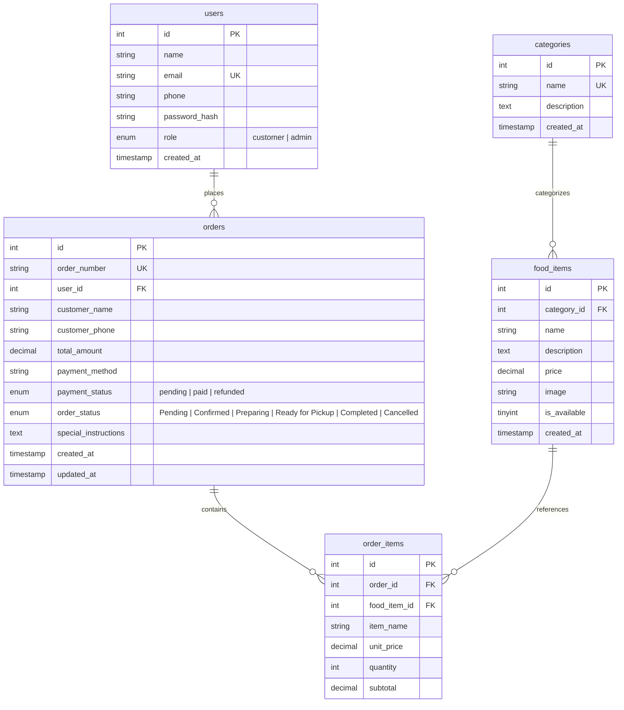

# 🍽️ CampusBite - Canteen Management System

> **A Complete, Production-Ready College Canteen Web Application Built with Pure PHP (OOP/PDO), MySQL, Bootstrap 5, and AWS Elastic Beanstalk.**

---

## 📋 Table of Contents
1. [Project Overview](#project-overview)
2. [Technology Stack](#technology-stack)
3. [Key Features](#key-features)
   - [Customer Experience](#customer-experience)
   - [Admin & Kitchen Console](#admin--kitchen-console)
4. [Database Architecture](#database-architecture)
5. [Prerequisites](#prerequisites)
6. [Local Development Setup (XAMPP / PHP CLI)](#local-development-setup-xampp--php-cli)
7. [Initial Administrator & Demo Accounts](#initial-administrator--demo-accounts)
8. [AWS Elastic Beanstalk & RDS Deployment Guide](#aws-elastic-beanstalk--rds-deployment-guide)
   - [Architecture Overview](#aws-architecture-overview)
   - [Step 1: Create AWS RDS MySQL Instance](#step-1-create-aws-rds-mysql-instance)
   - [Step 2: Create AWS Elastic Beanstalk Environment](#step-2-create-aws-elastic-beanstalk-environment)
   - [Step 3: Configure Environment Variables](#step-3-configure-environment-variables)
   - [Step 4: Package and Deploy Application](#step-4-package-and-deploy-application)
   - [Step 5: Persistent Media Storage with Amazon S3](#step-5-persistent-media-storage-with-amazon-s3)
   - [Step 6: Health Checks and HTTPS Configuration](#step-6-health-checks-and-https-configuration)
9. [Application Security Architecture](#application-security-architecture)
10. [Troubleshooting Guide](#troubleshooting-guide)
11. [Limitations & Future Roadmap](#limitations--future-roadmap)

---

## 🌟 Project Overview

**CampusBite** is designed specifically for college campuses, university food courts, and cafeteria networks to eliminate long physical counter queues. Students and faculty can browse the food menu, customize meal quantities, submit orders from their smartphones or laptops, and collect their hot meals right when ready. 

Behind the counter, canteen managers and chefs access an interactive, role-restricted **Admin Management Console** with real-time order tracking, kitchen workflow status controls, food item stock toggles, sales reporting, and customer metrics.

The project is built deliberately in **clean, structured, object-oriented PHP with PDO** (no heavyweight monolithic frameworks like Laravel), making it straightforward for students to comprehend, modify, explain during academic viva examinations, and deploy effortlessly to cloud infrastructure.

---

## 🛠️ Technology Stack

| Layer | Technologies & Tools |
| :--- | :--- |
| **Frontend** | HTML5, CSS3, JavaScript (ES6+), Bootstrap 5.3, Bootstrap Icons, Chart.js |
| **Backend** | Object-Oriented PHP 8.2+ (Compatible with AWS Elastic Beanstalk AL2 / AL2023) |
| **Database** | MySQL 8.0 / MariaDB (Local via XAMPP; Production via Amazon RDS MySQL) |
| **Data Access** | PDO (PHP Data Objects) with Prepared Statements & Database Transactions |
| **Session & Auth** | Secure PHP Sessions (HttpOnly, SameSite=Lax, Session ID Regeneration, Bcrypt Hashing) |
| **Cloud Hosting** | AWS Elastic Beanstalk (PaaS), AWS Systems Manager, Application Load Balancer (ALB) |
| **Database Cloud** | AWS RDS (Relational Database Service) Multi-AZ / Single-AZ MySQL |
| **Configuration** | `.ebextensions` (PHP INI tuning, directories), `.platform` (Nginx proxy configuration) |

---

## 🎯 Key Features

### 👤 Customer Experience
* **Modern Food Discovery:**
  - Engaging hero banner, brand identity, and today's kitchen specials.
  - Category filtering: *Breakfast, Meals, Snacks, Beverages, Desserts*.
  - Live search bar by dish name and ingredients.
  - Transparent pricing displayed in Indian Rupees (**₹**).
  - Dynamic stock badges (*In Stock* vs. *Sold Out*).
* **Secure Customer Authentication:**
  - Registration with full name, college email, 10-digit phone number, and password.
  - Password hashing using PHP's native `password_hash()` (Bcrypt).
  - Session hijacking protection with automatic `session_regenerate_id(true)`.
  - Customer profile page with password change capability.
* **Smart Shopping Cart & Checkout:**
  - Client and server-synchronized shopping cart.
  - Real-time cart badge counter in the navigation bar.
  - Server-side price and stock validation (prevents client-side price tampering).
  - Special kitchen instructions field (e.g. *"extra spicy"*, *"no onions"*).
  - Initial counter payment option: **Cash at Counter on Pickup**.
  - Database transactional execution (`PDO::beginTransaction`) guarantees atomic consistency.
* **Live Order Tracking & History:**
  - Visual 5-stage order progress stepper:
    $$\text{Pending} \longrightarrow \text{Confirmed} \longrightarrow \text{Preparing} \longrightarrow \text{Ready for Pickup} \longrightarrow \text{Completed}$$
  - Lightweight auto-polling mechanism on the order details page (`/order-details.php?id=X&ajax=status`).
  - Safe customer cancellation permitted while order is in `Pending` state.
  - Printable customer invoices and digital receipts.

### 🛡️ Admin & Kitchen Console
* **Overview Analytics Dashboard:**
  - Real-time KPI summary: Today's Sales (₹), Today's Orders, Total Lifetime Orders, Registered Customers.
  - 7-Day interactive Sales Trend Bar Chart (powered by Chart.js).
  - Order Status Distribution Donut Chart.
  - Live table of recent orders with status badges.
* **Food & Menu Management:**
  - Add, edit, and safely delete food items.
  - Image upload engine with server-side MIME type verification (`finfo`), size limiting ($\le 2\text{ MB}$), and non-guessable file renaming.
  - One-click instant stock toggle (*In Stock* / *Sold Out*).
* **Category Management:**
  - Manage menu classifications.
  - Integrity safeguards: prevents accidental deletion of categories currently linked to active dishes.
* **Order Operations & Kitchen Workflow:**
  - Comprehensive order table with search by Order Number, Customer Name, or Phone.
  - Date filtering: *Today, Yesterday, Past 7 Days, Custom Date*.
  - Kitchen workflow state enforcement:
    - $\text{Pending} \to \text{Confirmed} \to \text{Preparing} \to \text{Ready for Pickup} \to \text{Completed}$.
    - Disallows invalid transitions (e.g. reverting Completed back to Pending).
  - Payment collection toggle (*Pending* $\to$ *Paid*).
  - Printable Kitchen Order Tickets (KOT) with `@media print` optimized CSS.
* **Customer Management:**
  - View registered customer directory, contact numbers, order frequency, and total expenditure.
  - Strictly conceals password hashes and sensitive authentication secrets.
* **Sales & Financial Reports:**
  - Filterable sales summaries by custom date ranges, this month, or last month.
  - Revenue, completed vs. cancelled orders, and average order value.
  - Top-selling dishes ranked by volume.
  - Printable financial audit reports.

---

## 🗄️ Database Architecture

The database schema is fully normalized and enforces foreign keys, cascading rules, and composite indexes.



---

## 💻 Prerequisites

Ensure you have the following installed on your development workstation:
* **PHP:** Version 8.2 or later (with `pdo`, `pdo_mysql`, `fileinfo`, `json`, and `session` extensions enabled)
* **MySQL:** Version 8.0+ or MariaDB 10.4+
* **Web Server:** Apache (via XAMPP / WampServer) OR the native PHP built-in web server
* **Web Browser:** Modern browser (Chrome, Edge, Firefox, Safari)

---

## 🚀 Local Development Setup (XAMPP / PHP CLI)

### Option A: Using XAMPP (Recommended for College Labs)
1. **Start Apache and MySQL:**
   - Launch the **XAMPP Control Panel**.
   - Click **Start** for Apache and MySQL.
2. **Deploy Code into `htdocs`:**
   - Copy or symlink this project directory to your XAMPP webroot:
     ```
     C:\xampp\htdocs\canteen-management-system
     ```
3. **Initialize Database:**
   - Open your browser and navigate to the built-in database setup wizard:
     ```
     http://localhost/canteen-management-system/database/setup.php
     ```
   - Click **"Run Database Setup & Seed"**.
   - *Alternative via phpMyAdmin:*
     - Open `http://localhost/phpmyadmin/`.
     - Create database `canteen_db`.
     - Import `database/schema.sql`, then import `database/seed.sql`.
4. **Access the Application:**
   - **Customer Portal:** `http://localhost/canteen-management-system/`
   - **Admin Console:** `http://localhost/canteen-management-system/admin/login.php`

---

### Option B: Using PHP Built-In Development Server
You can run the application directly from the project directory without moving files into `htdocs`:

1. Open PowerShell or Command Prompt in the project folder:
   ```powershell
   cd "C:\Users\E AKASH REDDY\.gemini\antigravity\scratch\canteen-management-system"
   ```
2. Run database setup:
   ```powershell
   php database/setup.php
   ```
3. Launch the development server:
   ```powershell
   php -S localhost:8000
   ```
4. Open your browser:
   - **Customer Website:** `http://localhost:8000/`
   - **Admin Dashboard:** `http://localhost:8000/admin/login.php`
   - **System Health Check:** `http://localhost:8000/health.php`

---

## 🔑 Initial Administrator & Demo Accounts

The database seeder pre-provisions two test accounts for immediate demonstration:

| Portal | Role | Email | Password |
| :--- | :--- | :--- | :--- |
| **Admin Console** | Administrator | `admin@canteen.local` | `Admin@123` |
| **Customer Portal** | Student / Customer | `customer@canteen.local` | `Customer@123` |

### Creating a New Administrator Securely
To comply with security guidelines, public admin registration is disabled. Create additional admin accounts via the included CLI tool:

```powershell
php admin/create-admin.php "Head Chef" "chef@college.edu" "SecurePassword2026!" "9876543210"
```

Or visit `http://localhost:8000/admin/create-admin.php` while authenticated as an administrator.

---

## ☁️ AWS Elastic Beanstalk & RDS Deployment Guide

### AWS Architecture Overview
```
           Internet
              │
              ▼
   [ Application Load Balancer ]
              │
       (Port 80 / 443)
              ▼
   [ Elastic Beanstalk EC2 ] ──> Logs: CloudWatch
     - Platform: PHP 8.2 AL2023
     - Web Server: Nginx + PHP-FPM
     - App: CampusBite Canteen
              │
        (VPC Port 3306)
              ▼
   [ AWS RDS MySQL Instance ]
     - Database: canteen_db
     - Storage: Multi-AZ Automated Backups
```

---

### Step 1: Create AWS RDS MySQL Instance
1. Open the **AWS Management Console** and navigate to **Amazon RDS**.
2. Click **Create database**:
   - **Engine type:** MySQL
   - **Engine version:** MySQL 8.0 (or latest available)
   - **Templates:** Free tier (for development/academic use) or Production
   - **DB instance identifier:** `canteen-db`
   - **Master username:** `canteen_admin`
   - **Master password:** Choose a strong password (e.g. `Canteen#Aws2026!`)
   - **Initial database name (under Additional Configuration):** `canteen_db`
   - **VPC Security Group:** Create new or select existing (e.g. `canteen-rds-sg`).
3. Note the **RDS Endpoint** (e.g. `canteen-db.c12345678.us-east-1.rds.amazonaws.com`).
4. **Security Group Rule:** In the RDS security group, add an **Inbound Rule**:
   - **Type:** MySQL/Aurora (3306)
   - **Source:** The security group of your Elastic Beanstalk EC2 instances.

---

### Step 2: Create AWS Elastic Beanstalk Environment
1. Navigate to **AWS Elastic Beanstalk** $\to$ **Applications** $\to$ **Create application**:
   - **Application name:** `campus-canteen-management`
2. **Environment tier:** Web server environment
   - **Environment name:** `campus-canteen-prod`
3. **Platform:**
   - **Platform:** `PHP`
   - **Platform branch:** `PHP 8.2 running on 64bit Amazon Linux 2023`
4. **Application code:** Choose *Upload your code* (or upload the sample first, then deploy the zip in Step 4).

---

### Step 3: Configure Environment Variables
In Elastic Beanstalk, go to **Configuration** $\to$ **Updates, monitoring, and logging** $\to$ **Platform software (Environment properties)**:

Add these key-value pairs:

| Property Name | Example Value | Description |
| :--- | :--- | :--- |
| `APP_ENV` | `production` | Enables production error suppression |
| `DB_HOST` | `canteen-db.c12345678.us-east-1.rds.amazonaws.com` | Your AWS RDS Endpoint |
| `DB_PORT` | `3306` | MySQL Port |
| `DB_NAME` | `canteen_db` | Database Name |
| `DB_USER` | `canteen_admin` | Master RDS Username |
| `DB_PASSWORD` | `Canteen#Aws2026!` | Master RDS Password |

> [!NOTE]
> If you attach RDS directly through Elastic Beanstalk's database addon, AWS automatically injects `RDS_HOSTNAME`, `RDS_PORT`, `RDS_DB_NAME`, `RDS_USERNAME`, and `RDS_PASSWORD`. The application's `config/database.php` automatically recognizes both formats!

---

### Step 4: Package and Deploy Application
1. Package the project into a deployment ZIP file. Make sure you zip the **contents** of the directory (so `index.php` is in the zip root):

   **PowerShell:**
   ```powershell
   cd "C:\Users\E AKASH REDDY\.gemini\antigravity\scratch\canteen-management-system"
   Compress-Archive -Path * -DestinationPath "..\canteen-deploy.zip" -Force
   ```
2. In the Elastic Beanstalk console:
   - Click **Upload and deploy**.
   - Select `canteen-deploy.zip`.
   - Provide a version label (e.g. `v1.0.0`).
   - Click **Deploy**.
3. **Import Database Schema to RDS:**
   - Connect to RDS from your local workstation using MySQL Workbench or CLI:
     ```powershell
     mysql -h canteen-db.c12345678.us-east-1.rds.amazonaws.com -u canteen_admin -p canteen_db < database/schema.sql
     mysql -h canteen-db.c12345678.us-east-1.rds.amazonaws.com -u canteen_admin -p canteen_db < database/seed.sql
     ```
   - Or visit `https://<your-eb-url>/database/setup.php` once to initialize.

---

### Step 5: Persistent Media Storage with Amazon S3
In Elastic Beanstalk, local EC2 instances are ephemeral (scaling out, replacing instances, or redeploying replaces the local disk).

For high-volume production deployments:
1. Create an Amazon S3 Bucket: `canteen-food-images`.
2. Attach an IAM role policy to the Elastic Beanstalk EC2 instance role (`aws-elasticbeanstalk-ec2-role`) granting `s3:PutObject` and `s3:GetObject`.
3. In `includes/functions.php`, you can direct image uploads to the bucket or use Amazon CloudFront to serve media from `https://cdn.canteen.college.edu/foods/filename.jpg`.
4. The codebase includes SVG-based fallback images so that the application functions seamlessly even before an S3 bucket is provisioned.

---

### Step 6: Health Checks and HTTPS Configuration
* **Health Check URL:** Configure the Elastic Beanstalk Process health check path to `/health.php`.
* **Health Check Response:**
  ```json
  {
      "status": "UP",
      "timestamp": "2026-10-21T18:21:58+02:00",
      "app_name": "CampusBite Canteen",
      "environment": "production",
      "php_version": "8.2.12",
      "database": {
          "connected": true,
          "message": "Connected successfully to canteen_db on 127.0.0.1:3306",
          "response_ms": 5.27
      },
      "disk": {
          "upload_dir_writable": true
      }
  }
  ```
* **HTTPS / SSL:**
  1. In **AWS Certificate Manager (ACM)**, request a free SSL certificate for your custom domain (e.g. `canteen.college.edu`).
  2. In Elastic Beanstalk $\to$ **Configuration** $\to$ **Load balancer**, add an HTTPS listener on Port 443 with your ACM certificate.

---

## 🔒 Application Security Architecture

| Security Measure | Implementation Mechanism |
| :--- | :--- |
| **SQL Injection Prevention** | 100% of queries use PDO Prepared Statements with bound parameters (`$stmt->execute([$param])`). Emulated prepares are disabled. |
| **Cross-Site Scripting (XSS)** | Every customer and admin output is filtered through the helper `e()` which uses `htmlspecialchars($str, ENT_QUOTES, 'UTF-8')`. |
| **Cross-Site Request Forgery (CSRF)** | State-changing forms embed `csrfField()`, verified via cryptographically secure `hash_equals()` in `verifyCsrfToken()`. |
| **Password Hashing** | Bcrypt algorithm via `password_hash($pwd, PASSWORD_DEFAULT)` with modern work factor; verified via `password_verify()`. |
| **Session Protection** | Cookies configured with `HttpOnly=true`, `SameSite=Lax`, and `Secure` flags. Session IDs are regenerated upon login. |
| **Price Tampering Protection** | Browser never sends authoritative prices. The server re-reads dish prices from the database during order calculation. |
| **Strict File Upload Validation** | Inspects internal binary magic numbers via PHP `finfo` (`FILEINFO_MIME_TYPE`), validates against an allowed whitelist, limits file size to 2 MB, and renames files with random hex tokens. |
| **Role-Based Access Control (RBAC)** | Administrative pages unconditionally call `requireAdmin()`, preventing privilege escalation. |

---

## 🔧 Troubleshooting Guide

| Issue | Root Cause | Solution |
| :--- | :--- | :--- |
| **"Database connection failed"** | MySQL service not running or bad credentials | Ensure MySQL is running. Verify `DB_HOST`, `DB_USER`, `DB_PASSWORD` in `.env` or Elastic Beanstalk environment properties. |
| **Health check reports HTTP 503** | Database unreachable from web server | Check security group inbound rules on AWS RDS to ensure port 3306 is open to Elastic Beanstalk's security group. |
| **Image upload fails** | File exceeds size limit or invalid format | Upload files under 2 MB in JPG, PNG, or WebP format. Ensure `assets/images/foods/` is writable (`chmod 775`). |
| **CSRF Token Mismatch** | Expired session or back-button re-submission | Refresh the form page and resubmit. Ensure cookies are enabled in the client browser. |
| **Nginx 413 "Request Entity Too Large"** | Web server body limit reached | Configured in `.platform/nginx/conf.d/elasticbeanstalk.conf` as `client_max_body_size 15M;`. |

---

## 🔮 Limitations & Future Roadmap

* **Payment Gateways:** Currently supports **Cash at Counter on Pickup**. Future releases can easily integrate Razorpay, Stripe, or Paytm UPI QR callbacks in `checkout.php`.
* **Push Notifications:** Future integration with Firebase Cloud Messaging (FCM) or SMS APIs (Twilio / AWS SNS) to alert students the exact second their order reaches the *"Ready for Pickup"* stage.
* **Kitchen Display System (KDS):** A dedicated fullscreen tablet view for kitchen line cooks with audio buzzers when new orders arrive.

---

## 📄 License & Academic Attribution
Created for academic demonstration, college software engineering project requirements, and AWS cloud deployment demonstrations. Distributed under the MIT Open Source License.
